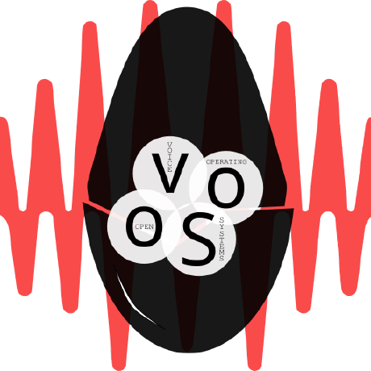

# ha-ovos-integration

**One Home Assistant integration for any OpenVoiceOS** – ovos-installer, raspOVOS, a Mark II, an OVOS in a VM, [Emkay](https://emkay.ai) (OVOS in a browser), and the [haos-ovos-addons](https://github.com/andlo/haos-ovos-addons).

Each OVOS shows up as a **device**, with what can be seen and set on it as entities – volume, listening on/off, state, last question and answer, its own sensors – so automations can turn off listening at night, turn the volume down, make it say something or ask it something. Everything comes from the OVOS bus, which every OVOS speaks, so it is the same whatever kind of OVOS it is.

With [ovos-control-panel](https://github.com/OpenVoiceOS/ovos-control-panel) on the device, HA also gets what the panel can set – language, units, voice, speech to text, wake word, skills on and off, **each skill's settings**, the release channel – and its health, updates, restart and reboot, and **backups** kept in HA. The device's **network log** (what it sent out, to whom) comes along as an event and sensors.

Devices that send audio, like [Emkay](https://emkay.ai), are also **Assist satellites**: pick their pipeline in HA, announce on them, start a conversation, set timers.

A **HiveMind master with satellites** – [Emkay Home](https://github.com/emkay-voice/emkay-home), or any hivemind-core – brings each satellite along as a device of its own, *connected via* the hub: the kitchen tablet, the bedroom phone, a Pi.

The device connects **to** Home Assistant, so it works for browsers and behind NAT, and no port is opened on the device. Home Assistant connecting to an OVOS over HiveMind itself is [#8](https://github.com/andlo/ha-ovos-integration/issues/8).

## OpenVoiceOS devices

1. Add the **OpenVoiceOS** integration and choose **An OpenVoiceOS device**. This lets devices connect to this Home Assistant.
2. Point the device at Home Assistant and log in:
   - **Emkay**: ⚙ → *Where should Emkay think?* → *Connect to my Home Assistant* (with Emkay thinking on the device), or Home Assistant as the brain (an Assist satellite).
   - **Emkay Home**: the **Home Assistant** card on the house page. Its Emkays come along by themselves.
   - **Any other OVOS**: [ovos-phal-plugin-ha-link](https://github.com/andlo/ovos-phal-plugin-ha-link), a PHAL plugin, with Home Assistant's address and a long-lived token in `mycroft.conf`. With [ovos-assist-pipeline-plugin](https://github.com/emkay-voice/ovos-assist-pipeline-plugin) next to it, what Assist knows ("turn off the light on the stairs") goes to Home Assistant. ([`tools/ovos_ha_bridge.py`](tools/ovos_ha_bridge.py) is a small reference client.)
3. The device appears under **Settings → Devices & services → Discovered**. Add it.

- [docs/devices.md](docs/devices.md) – the entities and actions, and the bus messages behind them
- [docs/protocol.md](docs/protocol.md) – the protocol, for anyone writing a client

## The haos-ovos-addons

The integration is also the companion of [haos-ovos-addons](https://github.com/andlo/haos-ovos-addons): choose **The OpenVoiceOS add-ons on this Home Assistant** when adding it. That part talks to the add-ons over their own HTTP APIs and is set up as before; entries from before 0.1.0 keep working.

### What it does

Adds one integration entry, **"OpenVoiceOS"**, with:

- **Shared configuration** — language and each add-on's API URL, as ordinary `text` entities, kept in sync with the shared `mycroft.conf` on `/share`.
- **Guided voice setup** — a subentry flow that runs `ovos-core`'s own autoconfigure, picking sensible TTS/STT plugins for your language.
- **Skill management** — one config subentry per installed skill:
  - *Add a skill* from `ovos-skills`' curated catalog (a picklist), or from `ovos-skills-extra` (type a PyPI name or git URL directly).
  - Each skill gets its own device in HA's device registry, with a live "installed version" sensor.
  - Non-sensitive settings (booleans, numbers, plain strings) show up as live, editable entities on that same device — no separate flow needed to see or change them.
  - *Reconfigure a skill's other settings* from its own `settingsmeta.json`, or inferred directly from its `settings.json` when it doesn't ship one — still the way to change anything not shown as a live entity.
  - An optional link to a self-hosted [ovos-skill-config-tool](https://github.com/OscillateLabsLLC/ovos-skill-config-tool) instance, for editing secrets or nested settings this integration deliberately keeps off its own live entities.
- **Persona configuration** — a subentry flow to choose which question-solver plugins `ovos-persona` uses, and in what order.

### Setup

1. Install and start the relevant [haos-ovos-addons](https://github.com/andlo/haos-ovos-addons) add-ons first.
2. Add the **OpenVoiceOS** integration in HA and choose *The OpenVoiceOS add-ons on this Home Assistant*.
3. On Home Assistant OS / Supervised, each add-on's API URL is filled in automatically by querying Supervisor — nothing to do here. On a non-Supervisor install (or if an add-on isn't found), fill in the missing URL(s) under the integration's own entities (e.g. `http://<hostname>:8500` for `ovos-skills`).
4. Use **Add sub-entry** on the integration to add skills, run voice setup, or configure persona.

## Thanks

- The idea of a browser as an Assist satellite over Home Assistant's WebSocket API comes from [Voice Satellite](https://github.com/jxlarrea/voice-satellite-card-integration) by jxlarrea.

## License

Licensed under the [Apache License 2.0](LICENSE), matching OpenVoiceOS's own project license.

The OpenVoiceOS logo is used with attribution to the [OpenVoiceOS project](https://openvoiceos.org); this project is not officially affiliated with or endorsed by OpenVoiceOS.
